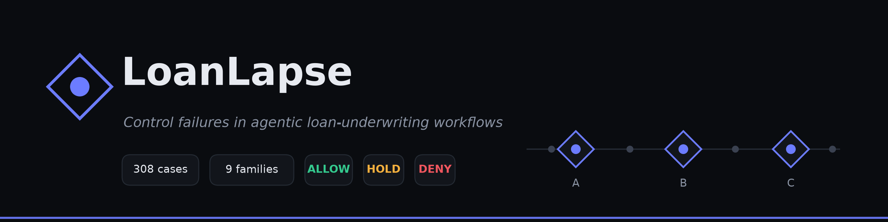

# LoanLapse

**A synthetic dataset of control failures in agentic loan-underwriting workflows.**

[](https://huggingface.co/datasets/RunCtrl-AI/LoanLapse)
[](https://creativecommons.org/licenses/by/4.0/)
[](LICENSE)
[](https://runctrl-studio.pages.dev)
<!-- [](https://doi.org/10.5281/zenodo.XXXXXXX) — added after the first release -->

LoanLapse captures a failure mode that ordinary, step-level guardrails miss: an agentic workflow where
**every individual step passes its own check, yet the workflow as a whole takes an unsound action.**
Each of the 308 cases is labeled with the correct *control decision* on the action at a workflow gate —
**ALLOW**, **HOLD**, or **DENY** — so any detection method can be scored against one consistent ground
truth.

> [!WARNING]
> **Fully synthetic.** No real people, accounts, or bank details. The mortgage/consumer-lending
> vocabulary is used for *shape only* — every rule here is invented for research. This data must **not**
> be used to make or justify real lending decisions. It was newly generated for this release and is not
> part of any model's pretraining data, and **no language model assigns any label**.

---

## TL;DR

- **What:** 308 synthetic cases of an AI loan-underwriting workflow, each labeled ALLOW / HOLD / DENY on
  the action at a control gate.
- **Why it's interesting:** the labels are set so that *checking each step in isolation is not enough* —
  you have to look at how the steps compose, or recompute a claim from raw records, to get them right.
- **How the labels are made:** by written rules, deterministically. No model, no human judgment call, no
  randomness. Re-running the generator reproduces the identical dataset.
- **Try it:** an interactive explainer, **[RunCtrl Studio](https://runctrl-studio.pages.dev)**, lets you
  browse every case, see the reasoning, and run the checks live in your browser.
- **Load it:** `load_dataset("RunCtrl-AI/LoanLapse")` — see [Load it](#load-it).

## The workflow, and where control runs

A loan file moves through a workflow of stages. Three of them are **control gates** — the points where
an action *commits* and becomes hard to undo. A detector runs at each gate and decides on the **action**.

```mermaid
flowchart LR
    I([Inquiry]) --> PQ([Prequalification]) --> IN([Application intake]) --> PR([Processing & credit])
    PR --> GA{{"Gate A<br/>Submit to underwriting"}}
    GA --> RA([Risk assessment]) --> CO([Conditions issuance])
    CO --> GB{{"Gate B<br/>Clear / waive condition"}}
    GB --> GC{{"Gate C<br/>Render decision"}}
    GC --> CL([Clear to close])
    classDef gate fill:#6C7CFF22,stroke:#6C7CFF,stroke-width:2px,color:#c9ceff;
    classDef node fill:#12151B,stroke:#2A3140,color:#cbd3e0;
    class GA,GB,GC gate
    class I,PQ,IN,PR,RA,CO,CL node
```



At each gate the detector returns a decision on the *action* — never on creditworthiness:

- **🟢 ALLOW** — the action is sound and taken by an authorized actor; let it commit. *(A legitimate
  decline is an ALLOW — the control permits the action, it doesn't re-judge the loan.)*
- **🟠 HOLD** — the action rests on something unsound: stale evidence, an incomplete package, an unknown
  result, a duplicate, a dropped obligation, a collapsed summary, an empty tool reply. Block, fix,
  re-check.
- **🔴 DENY** — a hard authority violation: the actor proposing the action isn't allowed to.

## The idea in one minute

The whole point is that **a step-local check cannot catch these**. The 308 cases span three kinds of
failure:

| Kind | What it looks like | Example |
|---|---|---|
| **Compositional** | no single step is wrong; the fault appears only across steps | a value is computed, then its input is superseded by a newer version |
| **Single-point recount** | a claim is false when recomputed from the raw records | the package says "complete" while a required document is actually missing |
| **Single-point authority** | the wrong actor acts at one step | a bot proposes an action only an underwriter may propose |

## What's in the dataset

| | |
|---|---|
| Cases | **308** |
| Families (failure categories) | **9** |
| Scenarios | **28** (3 per family; 4 for segregation of duties) |
| Labels (control space) | **156 ALLOW · 132 HOLD · 20 DENY** |
| Detection classes (of 140 defect cases) | 75 compositional · 45 single-point recount · 20 single-point authority |
| Labeling | **rule-based** — no model is a label source |
| Generation | **deterministic** — reproduces exactly, no randomness |
| Corpus version · schema | `1.0.0` · `2.0.0` |

## What a case contains

Each case is a folder under `datasets/corpus/L1/v1.0.0/<case_id>/`. The design keeps **world truth**
(what's actually true) separate from **the agent's claims** (what it says), so a detector can be scored
on whether it catches the gap between them.

| File | Side | Holds |
|---|---|---|
| `case.json` | identity | id, family, scenario, variation, gate |
| `evidence.json` | world truth | documents (versioned), computed results (with input provenance), connector/tool results |
| `obligations.json` | world truth | conditions and how (or whether) they were resolved |
| `trace.json` | log | the ordered, timestamped events across workflow nodes |
| `proposal.json` | agent claim | the action proposed at the gate, and the claims it makes |
| `reference.json` | **ground truth** | the correct decision, which contract(s) fired, the rationale, the detection class |
| `injection.json` | present on injected cases | when a change was injected and the agent's state at that moment |

> [!NOTE]
> **One row per case.** For easy loading and the Hugging Face viewer, `loanlapse.jsonl` bundles each
> case's files into a single JSON line. The per-case folders remain the source of record for anyone who
> wants full fidelity.

## How the labels are made (and why you can trust them)

This is the part that matters most for an evaluation dataset, so it's spelled out:

- **Labels come from written rules, not a model or a person's judgment.** Each failure family has one rule
  (a "contract") that reads the raw records and decides ALLOW / HOLD / DENY. No LLM is anywhere in the
  label path.
- **Ground truth is independent of any detector.** The correct answer is fixed by the rule before, and
  separately from, running any detection method — so a method is genuinely tested, not graded against
  itself.
- **Recompute from raw, never from the summary.** Guarded quantities (versions, totals, who-resolved-
  what) are recomputed from the evidence, never read from a stored status field an agent could have gotten
  wrong.
- **Deterministic.** The generator uses no randomness; it varies cases by index. Running it again produces
  byte-for-byte the same 308 cases.

The rules live in [`policy/contracts.yaml`](policy/contracts.yaml) (one check per family) and
[`taxonomy/families.yaml`](taxonomy/families.yaml) (the family definitions); the generator is
[`scripts/generate_corpus_v1.py`](scripts/generate_corpus_v1.py).

## See it in action — RunCtrl Studio

### 👉 [runctrl-studio.pages.dev](https://runctrl-studio.pages.dev)

RunCtrl Studio is a free, interactive companion for *understanding* this dataset — a visualizer and
explainer you can open in any browser.

- **Browse the failure library** — the 9 families and 28 scenarios, each in plain language with the exact
  rule behind it.
- **Open any of the 308 cases** — see the full trace with the injected change highlighted, inspect the
  evidence (document versions, provenance chains, tool results), and read a verdict panel that contrasts
  what a shallow "every step passed" reading concludes against what the gate's recount concludes.
- **Run the checks live** — press *Run* and the nine control checks execute in your browser and return
  ALLOW / HOLD / DENY with the reasoning. They are a faithful re-implementation of the same rules in
  [`policy/contracts.yaml`](policy/contracts.yaml), and they agree with this dataset's ground truth on all
  308 cases.
- **Build your own case** — change a document version, a connector outcome, or who proposes the action,
  and watch the decision change.

> [!IMPORTANT]
> The Studio is an **explainer / visualizer only**. It does **not** generate the dataset or its labels,
> and it is **not required** to use the data. The dataset and its deterministic generator in this
> repository are the single source of truth — the Studio simply re-implements the published rules to make
> them explorable.

## Load it

```python
from datasets import load_dataset

ds = load_dataset("RunCtrl-AI/LoanLapse")     # Hugging Face
print(ds["train"][0]["case_id"])
```

Each row bundles one case's parts: `case`, `evidence`, `obligations`, `trace`, `proposal`, `reference`
(the ground truth), and — on injected cases — `injection`. Prefer the raw per-case folders? They're in
[`datasets/corpus/L1/v1.0.0/`](datasets/corpus/L1/v1.0.0/) in this repository.

## Reproduce it from scratch

Everything here is regenerated by two scripts. Requires **Python 3.11+**.

```bash
# 1. regenerate the corpus (deterministic; overwrites datasets/corpus/L1/v1.0.0/)
python3 scripts/generate_corpus_v1.py

# 2. validate every case (structure, provenance, actor authority, labels, counts)
pip install pyyaml
python3 scripts/validate_corpus.py
```

A clean run prints `all consistency checks passed on 308 corpus cases` and the label counts
`{'ALLOW': 156, 'HOLD': 132, 'DENY': 20}`. The generator uses only the Python standard library; the
validator additionally needs PyYAML. The validator checks file completeness, temporal/provenance ordering
(no evidence may postdate the proposal it supports), contract and boundary definitions, actor
authorization, referential integrity, and the mode/label and detection-class invariants.

## Splits

LoanLapse v1.0.0 ships as **one evaluation corpus** (no predefined train/validation/test split).

> [!TIP]
> If you need splits, split by **`group_id`** and keep every case in a group together — related cases (a
> defect and its clean twin, duplicates, siblings) share a `group_id`, and separating them would leak
> information across the split. Freeze your test set before measuring, and keep the clean (ALLOW) cases in
> every split, since precision needs them.

## Repository layout

```text
datasets/corpus/L1/v1.0.0/   the dataset: 308 cases + index.jsonl + MANIFEST.json
datasets/samples/v2/         a small, fully-traced sample to skim first
datasets/fixtures/L0/        hand-written seed fixtures
datasets/schemas/            JSON Schemas for each per-case file
taxonomy/families.yaml       the nine failure families and their rules
policy/contracts.yaml        the control contracts (one check per family)
scripts/                     generate_corpus_v1.py + validate_corpus.py (reproduce & check)
LICENSE                      MIT (code)
datasets/LICENSE             CC BY 4.0 (data)
```

## Limitations

- **One domain.** LoanLapse covers a single synthetic workflow (loan underwriting). The abstractions —
  evidence, obligation, actor, boundary, control decision — are domain-independent, but this release only
  instantiates them in lending.
- **Synthetic, not naturalistic.** Cases are constructed to isolate specific failure modes cleanly; they
  are not samples of real agent traces. That's the point (clean, labeled contrasts), but surface realism
  is secondary to the control logic.
- **Control decisions, not credit decisions.** Nothing here models creditworthiness; DTI/LTV figures are
  illustrative scaffolding, not a lending model.
- **Snapshot of v1.0.0.** Nine of the taxonomy's families are instantiated here; others are planned.

## Ethics and responsible use

All data is synthetic — no real names, account numbers, or personal information. **Intended use:** research
on control and guardrail methods for agentic workflows. **Not for:** credit modeling, real lending or
underwriting decisions, or training systems that make them. The lending vocabulary is for shape only and
every rule is invented.

## License

- **Data** — [Creative Commons Attribution 4.0 International (CC BY 4.0)](https://creativecommons.org/licenses/by/4.0/); see [`datasets/LICENSE`](datasets/LICENSE).
- **Code** — [MIT](LICENSE).

## Citation

If you use LoanLapse, please cite:

```bibtex
@misc{loanlapse2026,
  title        = {LoanLapse: A Synthetic Dataset of Control Failures in Agentic Loan-Underwriting Workflows},
  author       = {Kundeti, Pavan Kumar and Grandhi, Sri Sai Charith and Gupta, Rajesh and Kumar, Sumit},
  year         = {2026},
  howpublished = {Hugging Face Datasets and GitHub},
  note         = {Archival DOI to be added upon release}
}
```

The work builds on *Compositional Policy Violations: When Step-Level Compliance Fails in Agentic AI
Workflows* (arXiv:2609.18820).

## Maintenance

Maintained by the LoanLapse authors; versioned on GitHub, mirrored to Hugging Face, and archived on Zenodo
with a DOI per release. Questions, issues, or errata: please [open an issue](https://github.com/runctrl-ai/LoanLapse/issues).
